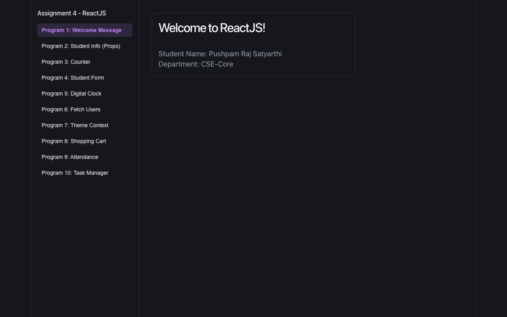
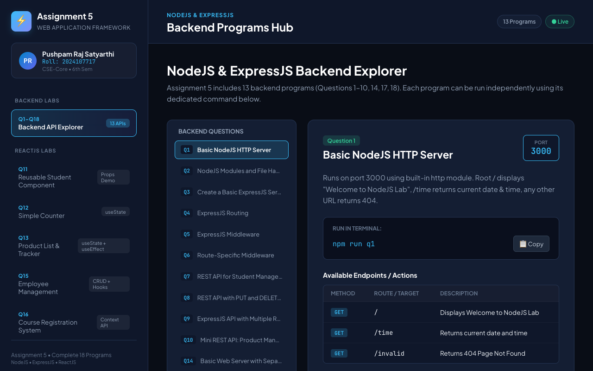

# Web Application Framework

Lab work for the Web Application Framework course, Semester 6, B.Tech CSE-Core at GITAM University. Six assignments, starting with plain HTML and ending with MongoDB. Each assignment lives in its own folder and can be run on its own.

Live demo of Assignment 4: https://assignment-4-gules.vercel.app



## What is in the repo

| Folder | Topic | Stack | How to open it |
|---|---|---|---|
| `Assignment-1/` | Personal profile page, and a four-page explanation of MVC | HTML | Open `profile.html` or `mvc/index.html` in a browser |
| `Assignment-2/` | Two static pages: an online bookstore (Q1) and a college fest site (Q2) | HTML, CSS | Open `Question-1/index.html` or `Question-2/index.html` |
| `Assignment-3/` | 40 small JavaScript problems, one HTML file each | HTML, JavaScript | Open `prob1.html` to `prob40.html` |
| `Assignment-4/` | 10 React programs behind a sidebar | React 19, Vite | `npm install && npm run dev` |
| `Assignment-5/` | 18 programs: Node and Express servers, REST APIs, and React components | Node, Express 4, React 19, Vite | See below |
| `Assignment-6/` | MongoDB shell scripts and Node scripts using the native driver | MongoDB, Node | See below |

Assignments 4 to 6 have their own README with the problem list and run commands. Assignment 5 also has a README inside every `Question-NN/` folder. A list of the 40 problems in Assignment 3 is in [docs/assignment-3-problems.md](docs/assignment-3-problems.md).

## Running things

Assignments 1 to 3 have no build step. Open the HTML files directly.

Assignment 4:

```bash
cd Assignment-4
npm install
npm run dev
```

Assignment 5 has two parts. `npm run dev` starts a Vite app that lets you browse the React components (Q11, Q12, Q13, Q15, Q16) and read about the backend programs. The backend programs are separate Node scripts, started with `npm run q1`, `npm run q2` and so on. They listen on ports 3000 and 5000 to 5010, and the endpoints are listed in `Assignment-5/README.md`. Only the programs that have an npm script (Q1 to Q10, Q14, Q17, Q18) can be started this way.

```bash
cd Assignment-5
npm install
npm run dev      # React explorer
npm run q17      # for example, the student CRUD API on port 5009
```



Assignment 6 needs a MongoDB server on `127.0.0.1:27017`. Questions 1 and 2 are run with `mongosh`, questions 3 and 4 with Node.

```bash
cd Assignment-6
npm install
npm run q3
```

Set `MONGO_URI` to use a different server.

## What each assignment shows

Assignment 1 covers basic HTML structure and the Model, View and Controller split, explained in prose with links between pages.

Assignment 2 is layout and styling practice with CSS: navbar, sections, cards and a footer.

Assignment 3 goes through the JavaScript basics in order: data types, arithmetic, conditions, loops, then form validation (email, phone, password, PIN code), and finally DOM events (click, mouseover, keydown, preventDefault).

Assignment 4 is the React fundamentals: props, `useState`, `useEffect` with cleanup, fetching from a public API, Context API, and `useReducer`.

Assignment 5 starts with the Node `http` module, moves to Express routing and middleware, then builds REST APIs with GET, POST, PUT and DELETE. Data is kept in memory, so it resets whenever a server restarts. The React part covers reusable components, Context and a CRUD interface.

Assignment 6 is CRUD against MongoDB: `insertMany`, `find` with filters, `updateOne` and `deleteOne`.

## Notes

This is coursework, so the programs follow the question papers and use sample data. The Assignment 4 question paper is included as `Assignment-4/Assignment 4-WAF.pdf`.

Only Assignment 4 is deployed. I checked the live link and the app loads. I did not run the Assignment 6 scripts, because they need a local MongoDB server.
